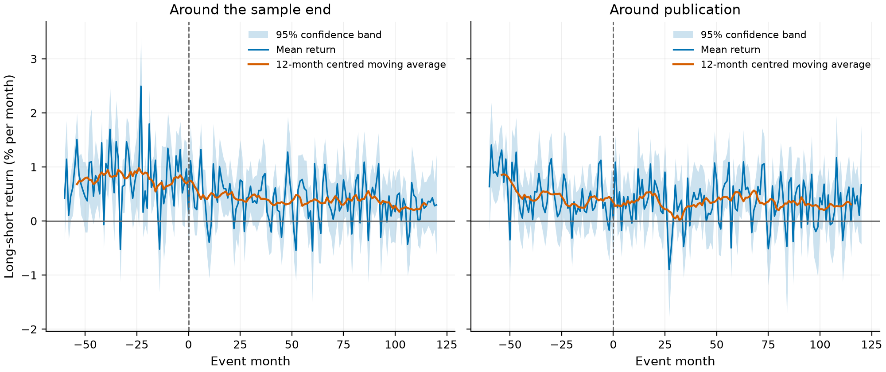

# anomaly-decay

Do stock-return anomalies survive being published? McLean and Pontiff (2016) found that long-short returns fall
after a predictor's original sample ends and fall further after publication. This repository replicates that
result with the open Chen–Zimmermann data, extends it through the latest data vintage, and documents every
specification and deviation. `make reproduce` rebuilds every number in the report from scratch.



<!-- results:start -->
**Headline.** Long-short anomaly returns are 0.239% per month lower after a predictor's original
sample ends and 0.337% per month lower after publication (198 predictors, 101,567 observations).

Relative to the 0.680% pooled in-sample mean, returns fall by 35.2% after the sample ends and fall
by 49.5% after publication.

| Window | Return (% per month) | SE | t-statistic | Change vs in-sample | McLean–Pontiff (2016) |
| --- | ---: | ---: | ---: | ---: | ---: |
| After the original sample ends | -0.239 | 0.068 | -3.53 | -35.2% | 26% |
| After publication | -0.337 | 0.074 | -4.56 | -49.5% | 58% |

The paper's column 1 reports declines of 0.150% and 0.337% per month on 97 predictors and 51,851
observations with FGLS standard errors; the replication estimates -0.239% and -0.337% per month on
198 predictors and 101,567 observations.

A 2,000-replication moving-block bootstrap (block length 12, seed 2027) gives 95% confidence
intervals of [-54.1%, -11.6%] for the post-sample change and [-68.5%, -25.7%] for the
post-publication change.

The pinned OSAP vintage is 202510, covering January 1926 through December 2024: 212 predictors in
total, 198 published by 2013 and 165 classified as clear.
<!-- results:end -->

## What this demonstrates

- A pooled panel regression of long-short returns on post-sample and post-publication window dummies, with
  predictor fixed effects and month-clustered standard errors, on the OSAP `op` portfolios.
- A pre-registered specification grid (`config/specifications.yaml`, frozen by the `specs-frozen` tag before any
  full-data estimate) covering two-way clustering, Driscoll–Kraay errors, the alternative publication
  convention, equal- and value-weighted deciles, factor-adjusted returns, normalized returns, and the
  full-extension sample.
- Block-bootstrap confidence intervals, a multiple-testing lens on in-sample t-statistics, and a data-vintage
  comparison, all pre-registered in `config/phase2_preregistration.yaml`.
- A Quarto report in which every number is an inline expression computed from `results/`.

## Reproduce it

Requires Python (`3.12`), [uv](https://docs.astral.sh/uv/) and, for the report, [Quarto](https://quarto.org)
(`1.10.19`).

```bash
uv sync --frozen
make reproduce-fixture   # offline: fixture data, exact panel cross-check, report render
make reproduce           # full pipeline from the pinned OSAP vintage
make phase2              # bootstrap, multiple-testing and vintage results
```

`make reproduce` downloads the pinned OSAP vintage once and caches it under `data/raw/`; later runs work from
the cache. `make reproduce-fixture` needs no network. The report is written to `report/_site/`.

## Report and documentation

- Report: <https://broiisapro.github.io/anomaly-decay/> (available after release)
- Architecture, interface contracts and data flow: [docs/architecture.md](docs/architecture.md)
- Epic write-ups: [docs/](docs/)

## Data and licence

The code is released under the MIT licence (see `LICENSE`). Returns come from the Chen–Zimmermann Open Source
Asset Pricing project (© Chen & Zimmermann) and Ken French's data library, whose terms of use apply to the
factor files. The repository does not redistribute raw data — only the derived tables and figures under
`results/`.

## Limitations

The replication follows OSAP's construction of each predictor rather than the original paper's; it uses
publication years without months; and it inherits OSAP's sample-period metadata. These choices, and their
effect on the comparison with McLean and Pontiff, are documented in the report's
[Deviations](https://broiisapro.github.io/anomaly-decay/#deviations-from-the-original-paper) and
[Limitations](https://broiisapro.github.io/anomaly-decay/#limitations) sections.
